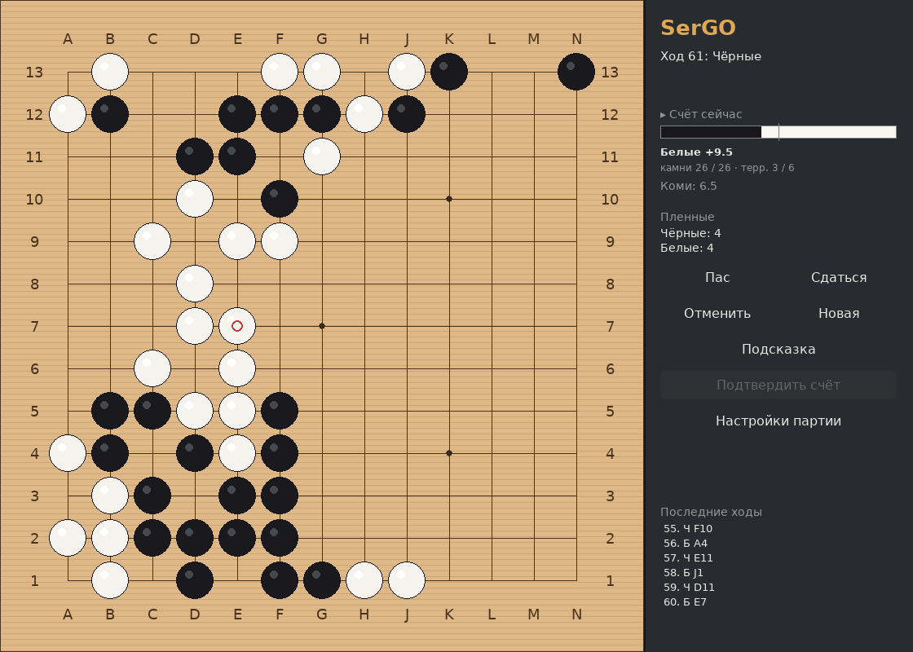
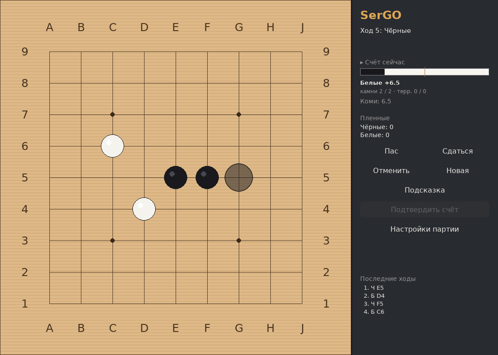
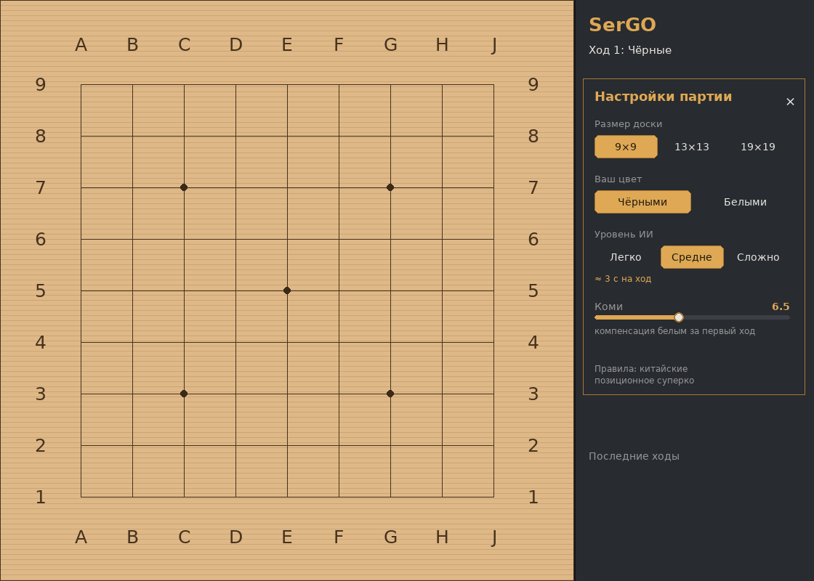
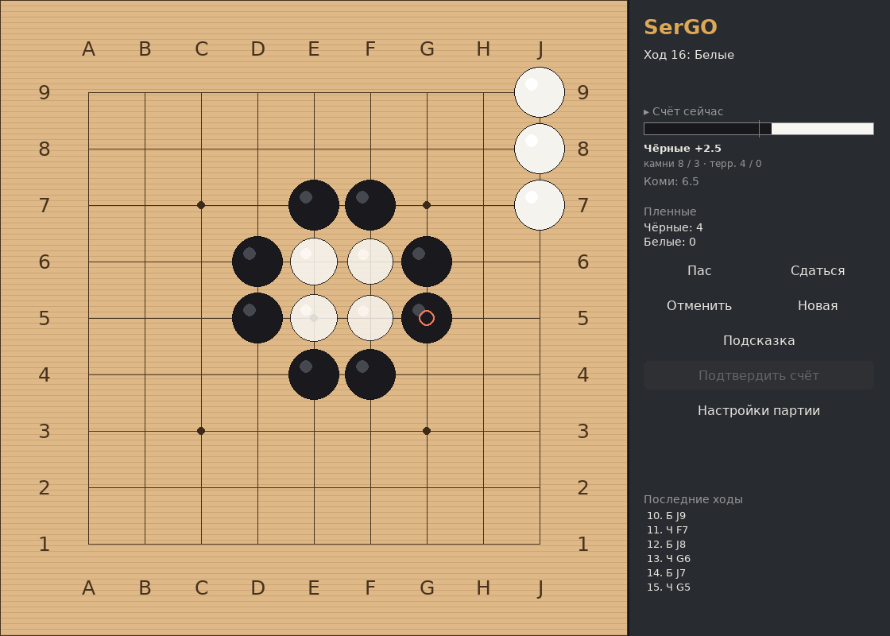
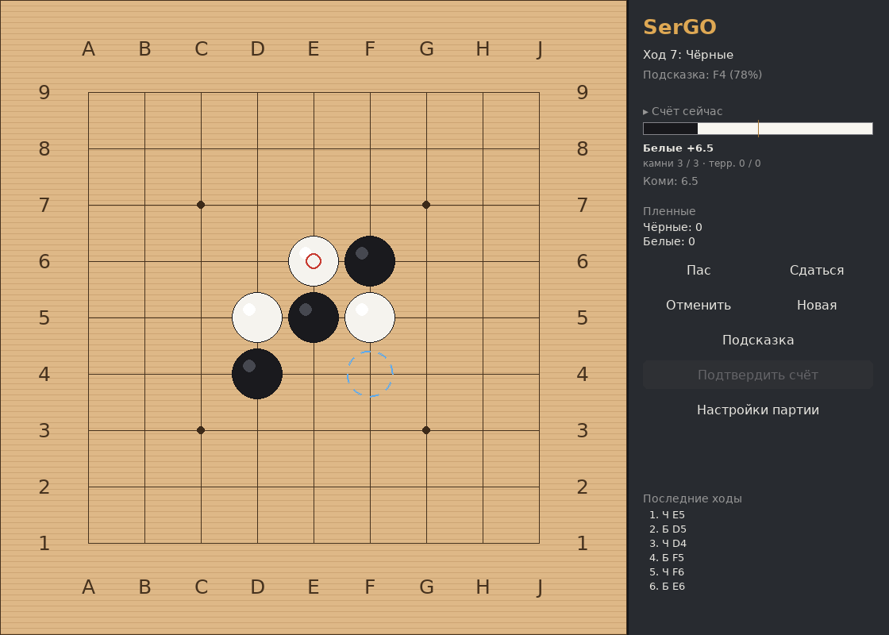
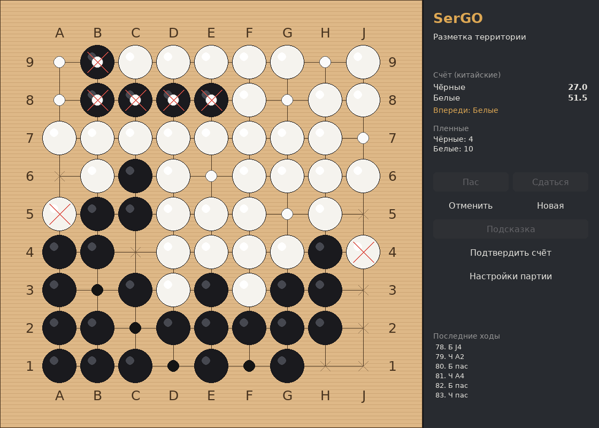
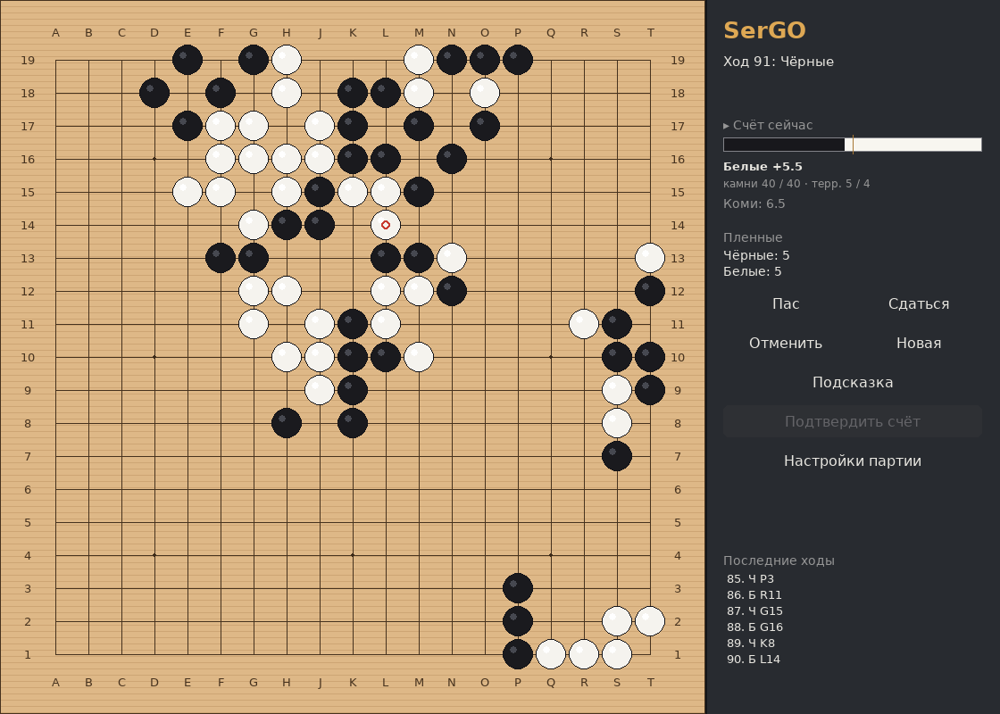
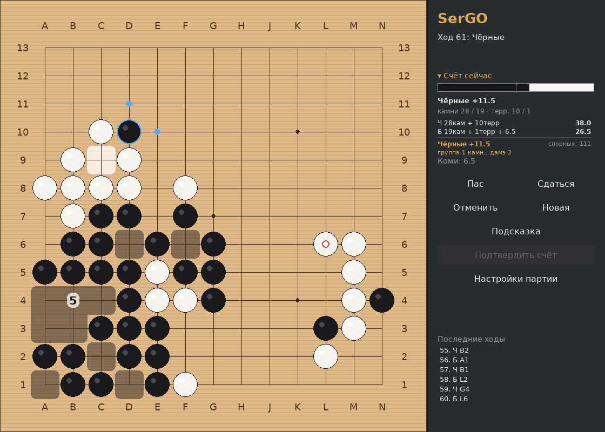

# SerGO — Го с собственным ИИ

Графическая игра в Го на Python + pygame. Свой движок правил, свой
MCTS-бот, интерфейс на русском языке.



## Возможности

- Доски 9×9, 13×13, 19×19.
- Китайские правила с позиционным суперко.
- ИИ на MCTS (UCT + RAVE) с тремя уровнями сложности.
- Полоса «Счёт сейчас»: реальный счёт, если партия закончится.
- Разбор счёта: заливка территорий на доске и расшифровка по сторонам.
- Анимация снятия камней — видно, что именно произошло.
- Подсказка хода, отмена, разметка территории при подсчёте.
- Терминальный режим без графики.

## Запуск

```bash
python3 start.py                    # доска 9×9
python3 start.py --size 13          # 13×13
python3 start.py --size 19          # 19×19
python3 start.py --level hard       # уровень ИИ
python3 start.py --cli --size 9     # игра в терминале
```

Нужен Python 3.9+ и библиотека `pygame` — она **не входит** в
репозиторий, её нужно установить. numpy не требуется.

```bash
pip install -r requirements.txt
```

Или вручную: `pip install "pygame>=2.1"`.

Терминальный режим (`--cli`) работает вообще без pygame — только
стандартная библиотека Python.

### Параметры командной строки

| Параметр | Значения | По умолчанию | Описание |
|---|---|---|---|
| `--size` | `9`, `13`, `19` | `9` | Размер доски |
| `--level` | `easy`, `normal`, `hard` | `normal` | Уровень ИИ. Задаёт время на ход и число рассматриваемых вариантов (см. «Настройки») |
| `--cli` | — | выключен | Терминальный режим без графики. Работает без pygame |
| `--help`, `-h` | — | — | Справка по всем параметрам |

Примеры:

```bash
python3 start.py                                  # игра 9×9, средний ИИ
python3 start.py --size 19 --level hard           # большая доска, сильный ИИ
python3 start.py --cli                            # терминал, 9×9
python3 start.py --cli --size 13 --level easy     # терминал, 13×13, слабый ИИ
```

Параметры `--size` и `--level` действуют в обоих режимах: значение
`--level` соответствует кнопкам «Легко / Средне / Сложно» в настройках
игры.

Если параметр не указан, берётся значение по умолчанию. Неверное
значение (например, `--size 11`) приводит к ошибке с подсказкой
допустимых вариантов.

### Запуск двойным кликом

Обычный `start.py` в Linux двойным кликом не запустится: система
считает `.py` текстовым файлом и открывает в редакторе. Нужен ярлык
`.desktop`. Он не входит в репозиторий, потому что содержит
абсолютный путь конкретной машины — создайте свой:

```bash
cat > SerGO.desktop <<'EOF'
[Desktop Entry]
Type=Application
Name=SerGO
Comment=Го с собственным ИИ
Exec=__PWD__/start.py
Path=__PWD__
Icon=__PWD__/sergo/icon.png
Terminal=false
Categories=Game;BoardGame;
EOF
chmod +x SerGO.desktop
sed -i "s|__PWD__|$(pwd)|g" SerGO.desktop
gio set SerGO.desktop metadata::trusted true
```

После этого двойной клик запускает игру в окне без терминала. Если
система всё равно спрашивает — правый клик → «Свойства» → «Права» →
«Разрешить выполнение».

При ошибке запуска откроется окно с текстом; если диалог недоступен,
подробности пишутся в `sergo_error.log`.

## Управление

| Действие | Как |
|---|---|
| Поставить камень | клик по пересечению |
| Пас | кнопка «Пас» или `P` |
| Отменить ход | кнопка «Отменить» или `Ctrl+U` |
| Подсказка хода | кнопка «Подсказка» |
| Настройки партии | кнопка «Настройки партии» или `F1` |
| Выход | `Esc` |

В режиме разметки территории клик по камню помечает его мёртвым.

## Скриншоты

| | |
|---|---|
|  |  |
| Начало партии 9×9 | Настройки партии |
|  |  |
| Анимация захвата группы | Подсказка хода |
|  |  |
| Разметка территории | Доска 19×19 |
|  | |
| Разбор счёта | |

Скриншоты генерируются скриптом:

```bash
python3 tools/make_screenshots.py
```

## Анимации

- **Появление камня** — 150 мс, камень растёт от 80% до полного
  размера. Видно, куда именно сыграли.
- **Снятие камней** — 400 мс, снятые камни гаснут и сжимаются. Камни,
  расположенные дальше от места захвата, гаснут на несколько
  миллисекунд позже — группа «осыпается» волной, а не исчезает сразу.

Пока идёт анимация, ход ИИ придерживается (не дольше 0.6 с), чтобы два
захвата подряд не накладывались друг на друга.

Длительности задаются константами `CAPTURE_DURATION` и `PLACE_DURATION`
в `sergo/ui/effects.py`.

## Счёт сейчас

В панели есть полоса: чёрная часть — доля чёрных в текущем счёте,
белая — белых. Под полосой написана разница в очках: «Чёрные +5.2»,
«Белые +26.5» или «ровно».

Это **настоящий подсчёт по китайским правилам**, тот же, что будет при
нажатии «Подтвердить счёт», — как если бы партия закончилась прямо
сейчас:

```
Чёрные = камни на доске + территория
Белые  = камни на доске + территория + коми
```

Пленные не учитываются: в китайских правилах снятый камень уже
«посчитан» тем, что его нет на доске, а его место стало территорией.
Число пленных показано отдельной строкой как справочная информация.

**Оговорка для дебюта.** Пока на доске камни только одного цвета,
вместо цифры выводится «позиция не определена». Причина не в
осторожности, а в математике подсчёта: один камень в углу формально
замыкает краевую область из 70+ пунктов, и счёт показывает +74.5.
На следующем ходу он же становится −6.5. Как только на доске
появляются оба цвета, краевые области касаются обоих и никому не
засчитываются, поэтому абсурдных значений больше не бывает —
проверено на реальных партиях: скачок больше 10 очков за ход
встретился 1 раз из 87, и это был тот самый первый ход.

## Разбор счёта

Клик по блоку **«Счёт сейчас»** в панели (или клавиша `S`) включает
разбор — режим, в котором видно, из чего складывается счёт.

[](docs/screenshots/score-breakdown.png)

**На доске:**

- территории заливаются цветом владельца: тёмная дымка — чёрные,
  светлая — белые;
- в центре каждой зоны написано, сколько она приносит пунктов
  (зон меньше 3 пунктов и больше 60 подписи не получают, чтобы не
  засорять доску);
- спорные зоны залиты серо-синим. Если спорная почти вся доска, они
  не заливаются вовсе: тогда и так видно, что территория не
  определена;
- наведение на камень подсвечивает всю группу и её дамэ, а в панели
  появляется строка «группа 4 камн., дамэ 6».

**В панели:**

```
Ч 25кам + 5терр      = 30.0
Б 23кам + 5терр +6.5 = 34.5
────────────────────────────
Белые +4.5     спорных: 111
```

В китайских правилах каждый камень стоит ровно одно очко, поэтому
вклад камней — это их количество. Вклад территории переменный, и
именно его показывает заливка зон.

Разбор доступен всегда, в том числе пока думает ИИ. Во время разметки
мёртвых камней после двух пасов подсветка группы отключается: там
клик по камню означает «пометить мёртвым».

## Подсказка хода

Кнопка **«Подсказка»** в панели — бот предлагает ход и показывает его
на доске.


**Что видно на доске:**

- **пунктирный голубой кружок** — точка, которую бот считает лучшей.
  Это именно рекомендация, а не обязательный ход: поставьте камень
  туда, если согласны, или сыграйте иначе;
- в панели строка вида **«Подсказка: F4 (78%)»**. Число в скобках —
  вероятность победы по оценке поиска после этого хода, с точки зрения
  того, кто ходит. 50% — позиция примерно равная, 90% — по мнению бота
  вы уверенно впереди.

Подсказка всегда считает на уровне «Сложно» и не дольше 2 секунд — не
зависит от выбранного уровня ИИ. Так совет остаётся полезным даже на
«Легко», а ждать его долго не приходится.

Кружок исчезает после вашего хода: он относился к прошедшей позиции.
Нажать «Подсказку» можно только когда ход ваш.

## Разметка территории

После двух пасов подряд партия не заканчивается автоматически —
включается режим разметки. Бот сам помечает вероятно мёртвые камни,
вы можете с этим не согласиться.


**Условные обозначения:**

- **маленькая точка цвета** на пустом пункте — территория. Чёрная
  точка — пункт засчитается чёрным, белая — белым;
- **красный крест** на камне — камень помечен мёртвым. Он будет снят
  с доски и засчитан противнику как пленный;
- **коричневый крестик** на пустом пункте — спорная область, она не
  достанется никому. Такие пункты появляются там, где граница между
  зонами ещё не закрыта камнями.

**Что можно делать:**

- клик по камню — пометить или снять пометку «мёртвый»;
- **«Подтвердить счёт»** — зафиксировать результат, партия окончена;
- **«Отменить»** или любой ход — вернуться к игре, если разметка
  оказалась неверной.

Если бот ошибся с мёртвыми камнями, поправьте вручную: счёт пересчитается
сразу.

## Настройки

- Размер доски: 9×9, 13×13, 19×19.
- Ваш цвет: чёрные или белые.
- Уровень ИИ: Легко / Средне / Сложно. Уровень сам задаёт время на ход
  и число рассматриваемых вариантов:

  | Уровень | 9×9 | 13×13 | 19×19 | Кандидатов | Намеренные ошибки |
  |---|---|---|---|---|---|
  | Легко | 1 с | 1.5 с | 2 с | 40 | 35% |
  | Средне | 3 с | 4 с | 5 с | 64 | 10% |
  | Сложно | 6 с | 8 с | 10 с | 96 | нет |

- Коми: 0–15 (по умолчанию 6.5) — компенсация белым за первый ход чёрных.
- Подсказка хода считается не дольше 2 секунд, независимо от уровня.

## Правила

Китайские: камни на доске + территория + коми. Позиционное суперко
запрещает повторение позиции. Самоубийство запрещено, кроме захвата.

Подсчёт территории при обоюдном пасе: бот сам размечает вероятно
мёртвые камни, вы можете поправить разметку кликами и подтвердить счёт
либо вернуться к игре.

## Устройство

```
sergo/
  board.py      правила: ходы, захваты, дамэ, ко, суперко
  zobrist.py    хеши позиций
  scoring.py    подсчёт (Tromp–Taylor) и японский режим
  policy.py     эвристики: глаза, атари, кандидаты ходов
  mcts.py       поиск: UCT + RAVE, бюджет по времени
  engine.py     уровни сложности, фоновый расчёт
  game.py       партия: история, отмена, сдача, счёт
  cli.py        терминальный режим
  ui/           pygame-интерфейс
    board_view.py  доска, камни, координаты
    effects.py     анимации захвата и постановки
    widgets.py     кнопки, ползунки
tools/          генератор скриншотов
docs/           скриншоты для README
tests/          150 тестов
```

## Тесты

```bash
python3 -m unittest discover -s tests
```

150 тестов: правила (ко, суперко, самоубийство, захваты), подсчёт
очков, уровни ИИ, партия, интерфейс, анимации и параметры командной
строки.

## Сила бота

Честно: это чистый MCTS на Python, а не KataGo.

- 9×9 — уверенный новичок, примерно 10–15 кю при нескольких секундах
  на ход;
- 13×13 — слабее;
- 19×19 — только локальная тактика, глобальной стратегии нет.

Движок ИИ сделан сменным: при желании можно подключить KataGo по GTP.
